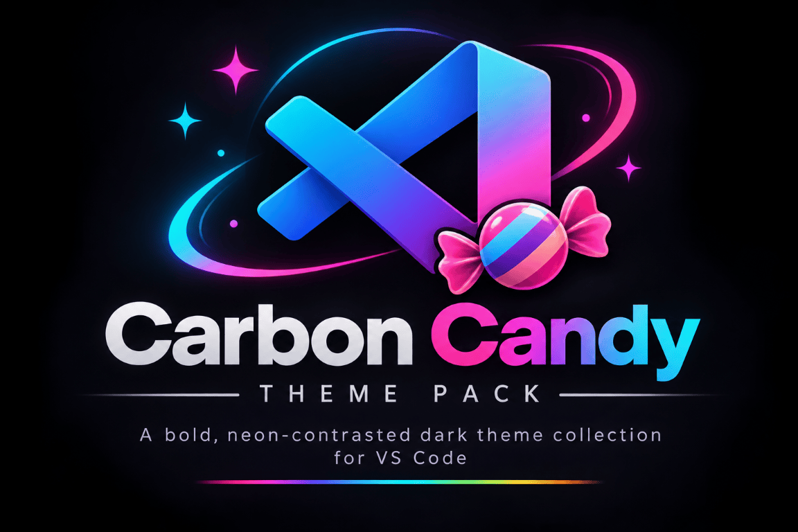
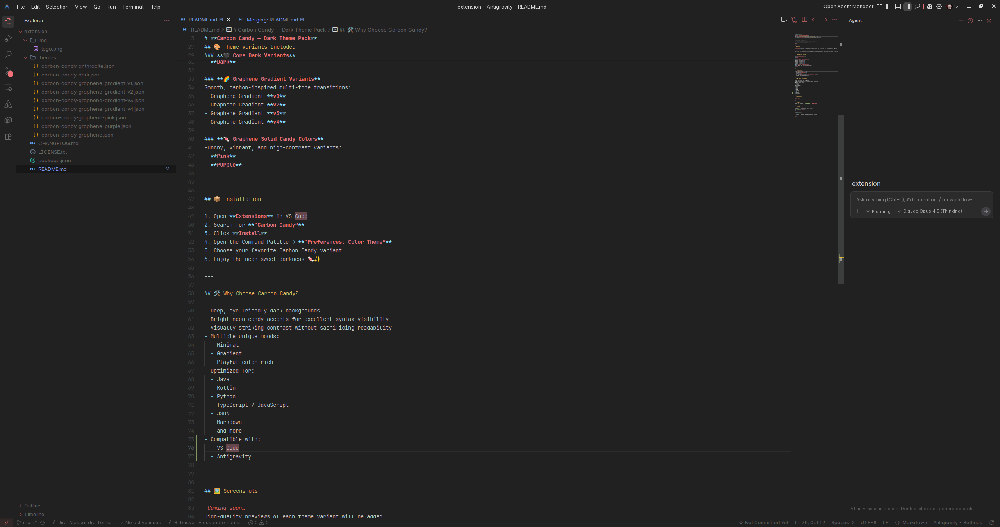
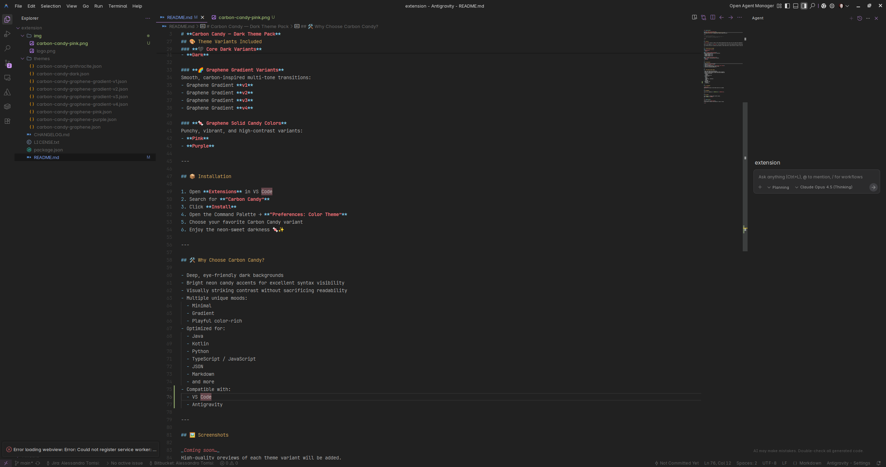
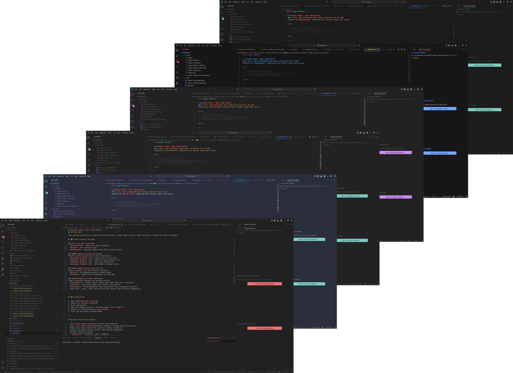

<div align="center">



Inspired by **Oxocarbon**, sweetened with vibrant candy-like colors.

<br/>

[](https://code.visualstudio.com/updates/v1_92)   

<br/>

[**Install**](#-installation) · [**Themes**](#-theme-variants-included) · [**Screenshots**](#️-screenshots) · [**Changelog**](./CHANGELOG.md)

<br/>


<br/>
<sub>built by <b>Viral Team</b></sub>

</div>

---

## ✨ Overview

**Carbon Candy** delivers a family of dark themes blending deep carbon tones with vivid candy-style highlights — pink, purple, gradients, and more.

Built on the elegance of **Oxocarbon**, this pack enhances syntax clarity while adding personality through energetic and playful color contrasts.

From refined anthracite to expressive neon palettes, Carbon Candy offers a sweet selection of moods for every developer — **32 variants** in total, all kept in sync with the latest VS Code UI.

## 🆕 What's New in 0.2.23

- **💜 Violet Collection** — three new purple-forward themes: **Nocturne**, **Synthwave** and **Amethyst**, each with a complete, independent palette (workbench colors, semantic tokens and TextMate scopes).
- **🪟 Modern UI support (VS Code 1.147+)** — every variant now defines the `modernUI.*`, `modernActivityBar.*`, `modernTab.*`, `modernEditorTab.*`, `surface.*`, `inlineChat.*` and `markdownAlert.*` tokens, so the floating shell, connected tabs, inline chat and markdown alerts follow the theme instead of the built-in palette.
- **🧹 Cleanup** — the `Aurora Thin Border` and `Carbon Thin Border` variants were removed to keep the pack focused. The remaining six thin-border variants are unchanged; if you had one of the removed themes selected, pick another variant from the Color Theme picker.
- **🎯 Anthracite** — the focused Command Center / Quick Input row now has a visible neutral-gray surface instead of blending into the background.

## 🎨 Theme Variants Included

```text
Carbon Candy
├─ Core Themes
│  ├─ Graphene
│  ├─ Carbon
│  ├─ Anthracite
│  ├─ Obsidian
│  └─ Dark
├─ Accent Themes
│  ├─ Bee
│  ├─ Bee Lightroom
│  ├─ Pink
│  ├─ Purple
│  ├─ Aurora
│  └─ Kawasaki
├─ Matrix Collection
│  ├─ Matrix
│  ├─ Matrix Emerald
│  ├─ Matrix Neon
│  └─ Matrix Cyber
├─ Gradient Collection
│  ├─ Gradient V1
│  ├─ Gradient V2
│  ├─ Gradient V3
│  └─ Gradient V4
├─ Thin Border Variants
│  ├─ Dark
│  ├─ Graphene
│  ├─ Obsidian
│  ├─ Bee
│  ├─ Pink
│  └─ Purple
├─ Classics
│  ├─ Palenight
│  ├─ Solarized Dark
│  ├─ Solarized Light
│  └─ Solarized Light Modern
└─ Violet Collection
   ├─ Nocturne
   ├─ Synthwave
   └─ Amethyst
```

### **🖤 Core Themes**
- **Anthracite** — Deep slate gray foundation
- **Dark** — Rich charcoal base
- **Graphene** — Balanced carbon black with vibrant accents
- **Carbon** — Deep focus theme with neutral gray palette
- **Obsidian** — Ultra-minimalist near-black with fully transparent borders

### **🌈 Gradient Collection**
Smooth, carbon-inspired multi-tone transitions:
- **Gradient V1** — Subtle teal-to-blue fade
- **Gradient V2** — Purple-to-pink gradient flow
- **Gradient V3** — Cool cyan progression
- **Gradient V4** — Warm amber-to-orange blend

### **🍬 Accent Themes**
Punchy, vibrant, and high-contrast variants:
- **Carbon Candy Pink** — Hot magenta accents on deep carbon
- **Carbon Candy Purple** — Royal violet highlights on dark base
- **Carbon Candy Bee** — Bumblebee yellow accents on dark base
- **Carbon Candy Bee Lightroom** — Bee accents on a lightroom-inspired gray base
- **Carbon Candy Aurora** — Crisp, clean variant with teal accents and excellent readability
- **Carbon Candy Kawasaki** — Lightroom-inspired gray base with bright light green 400 accents

### **🟩 Matrix Collection**
- **Carbon Candy Matrix** — Neon digital rain with luminous green highlights on a shadowed deep gray canvas
- **Carbon Candy Matrix Emerald** — Matrix variant with emerald accents and a refined dark base
- **Carbon Candy Matrix Neon** — Bright, vivid neon treatment for the Matrix family
- **Carbon Candy Matrix Cyber** — A sharper, cyber-inspired Matrix variant with boosted contrast

### **🌅 Classics**
Inspired by the legendary **Solarized** palette and classic dark compositions:
- **Palenight** — Classic purple-tinted dark theme with cyan foreground
- **Solarized Dark** — Dark variant using the Solarized color palette, optimized for visual comfort and syntax clarity
- **Solarized Light** — Light variant bringing Solarized's clarity to bright environments
- **Solarized Light Modern** — Refined light variant with a more modern balance of contrast and softness

### **💜 Violet Collection**
Three distinct purple-forward themes, designed as more than background swaps:

- **Carbon Candy Nocturne** — Midnight indigo and amethyst with cool lavender accents; the balanced, everyday choice.
- **Carbon Candy Synthwave** — Blue-black surfaces, electric violet, controlled magenta and cold cyan; the most futuristic and high-energy variant.
- **Carbon Candy Amethyst** — Warm aubergine and plum with dusty lilac, mauve and pearl text; the softest variant, with borderless focus treatment.

| Variant | Editor | Primary accent | Syntax character |
| --- | --- | --- | --- |
| Nocturne | `#191627` | `#A78BFA` | Violet keywords, cool blue functions, amber types, sage strings |
| Synthwave | `#111326` | `#B57BFF` | Electric violet keywords, cyan functions, cool-blue types, pink classes, mint strings |
| Amethyst | `#211821` | `#B98BD9` | Dusty violet keywords, muted lilac functions, warm ochre types, soft sage strings |

The three palettes include complete workbench colors, semantic token colors and TextMate scopes. Syntax colors use different hue families and retain category cues beyond red/green distinctions; comments and UI secondary text are designed to remain readable on their corresponding surfaces.

Contrast checks are provided by `scripts/audit_violet_collection.py` (WCAG AA checks for text and UI labels plus simulated protanopia, deuteranopia and tritanopia comparisons). Run it with `python3 scripts/audit_violet_collection.py` after regenerating themes with `python3 scripts/build_violet_collection.py`.

### **🔲 Thin Light-Gray Bordered Variants**
For users who want clearer visual separation between UI regions, thin light-gray bordered variants add a subtle 1px-style border around panels, the activity/side bar, editor groups, tabs and other UI surfaces.

- `carbon-candy-dark (thin-border)` — Dark theme with thin light-gray borders
- `carbon-candy-graphene (thin-border)` — Graphene variant with thin light-gray borders
- `carbon-candy-obsidian (thin-border)` — Obsidian variant with thin light-gray borders
- `carbon-candy-bee (thin-border)` — Bee variant with thin light-gray borders
- `carbon-candy-pink (thin-border)` — Pink variant with thin light-gray borders
- `carbon-candy-purple (thin-border)` — Purple variant with thin light-gray borders

These variants do not modify original themes; they are additional theme files you can select from the Color Theme picker.

---

## 📦 Installation

1. Open **Extensions** in VS Code  
2. Search for **“Carbon Candy”**  
3. Click **Install**  
4. Open the Command Palette → **“Preferences: Color Theme”**  
5. Choose your favorite Carbon Candy variant  
6. Enjoy the neon-sweet darkness 🍬✨

---

## 🛠️ Why Choose Carbon Candy?

- **32 unique theme variants** to match any preference
- Deep, eye-friendly dark backgrounds (ranging from near-black to charcoal)
- Bright neon candy accents for excellent syntax visibility
- Visually striking contrast without sacrificing readability
- Multiple aesthetic moods:
  - **Classic** — Anthracite, Dark, Graphene
  - **Gradient** — Smooth multi-tone transitions (v1–v4)
  - **Playful** — Pink and Purple with candy-style pops
  - **Minimalist** — Palenight, Carbon, Obsidian, Aurora with borderless design
  - **Violet** — Nocturne, Synthwave and Amethyst for purple-forward setups
- Optimized for:
  - Java
  - Kotlin
  - Python
  - TypeScript / JavaScript
  - JSON
  - Markdown
  - CSS / HTML
  - and more
- Compatible with:
  - VS Code
  - VS Code **Modern UI** (1.147+) — every variant ships the `modernUI.*` / `surface.*` / `modernEditorTab.*` tokens, so the floating shell and connected tabs keep the theme colors
  - VS Code **Agents window** (agent sessions) — every variant ships dedicated `agents*` / `agentSession*` color tokens, so the Agents window matches the editor instead of falling back to the default palette
  - Antigravity

### **🪟 Modern UI Support (VS Code 1.147+)**
VS Code 1.147 enables the **Modern UI** by default and themes it through a new set of color ids. Carbon Candy defines them for **every** variant, derived from each theme's own palette:

- **Shell** — `modernUI.shellBackground`, `modernUI.inactiveShellBackground`, `surface.background` / `foreground` / `border`
- **Activity bar** — `modernActivityBar.*` and `modernActivityBarItem.*` (active/hover states use the theme accent)
- **Tabs** — `modernTab.*`, `modernEditorTab.*`, `editorGroupHeader.connectedTabsBackground`, `tab.divider` and `tab.selectedBorderTop`
- **Panels & sashes** — `modernPanel.border`, `modernSash.gripForeground`
- **Inline chat** — `inlineChat.*`, `inlineChatDiff.*`, `inlineChatInput.*`
- **Markdown alerts** — `markdownAlert.note/tip/important/warning/caution` mapped to the theme's blue, green, purple, yellow and red
- **Chat surfaces** — `chat.fusionBadgeGradient*`, `chat.inputWorkingBorderColor2/3`, `chat.voiceListeningGlow`, `chat.voiceSpeakingGlow`, `chat.workingProgress*IconForeground`

`scripts/add_modern_ui_colors.py` regenerates these tokens from each theme's palette and never overwrites existing keys.

### **🤖 Agents Window Support**
VS Code's **Agents window** is themed through its own set of color ids (`agents.background`, `agentsPanel.*`, `agentsChatInput.*`, `agentsBadge.*`, `agentSession*`, `agentsMobileDiff.*`, …). Carbon Candy defines all of them for **every** variant, derived from each theme's own palette:

- **Shell & panels** — the Agents window shell, chat/files/terminal cards and the docked detail pane reuse the theme background, side bar and accent colors
- **Chat input** — background, foreground, border, focus border and placeholder follow the theme's input styling
- **Session list** — read indicators, selected/unfocused badge borders and the "needs input" marker use the theme's foreground, accent and warning colors
- **Badges & buttons** — New Session button, unread badges and update progress use the theme accent
- **Mobile changes list** — added/modified/deleted colors mirror the theme's Git decorations
- **Chat surfaces** — request bubbles, code borders, checkpoint separators, find matches, line counters and the thinking shimmer are aligned with the rest of the theme

Thin-border variants reuse their light-gray divider color for the Agents window cards, so the bordered look stays consistent across the whole workbench.

> **Note:** the Agents window runs with its own profile and its own `workbench.colorTheme`, so it does not inherit the theme selected in the editor window. Open the Color Theme picker (or the settings) **from the Agents window** and pick a Carbon Candy variant there.

### **Color Palette Highlights**
- **Backgrounds**: `#000000` to `#292D3E` (pure black to purple-tinted); the Violet Collection adds `#111326`–`#211821`
- **Foregrounds**: `#D4D4D4` to `#EEFFFF` (neutral to cyan-white)
- **Violet accents**: `#A78BFA` (Nocturne), `#B57BFF` (Synthwave), `#B98BD9` (Amethyst)
- **Syntax Tokens**: Vibrant candy colors
  - Blues: `#82AAFF`
  - Greens: `#C3E88D`
  - Reds: `#f07178`
  - Magentas: `#C792EA`
  - Yellows: `#FFCB6B`
  - Cyans: `#89DDFF`
  - Oranges: `#F78C6C`

---

## 🖼️ Screenshots

### Carbon Candy Pink


### Carbon Candy Purple


### Many combinations


---

## 📄 Changelog

See the full changelog in [`CHANGELOG.md`](./CHANGELOG.md).

---

## 🔖 License

This project is released under the MIT License.  
See [`LICENSE`](./LICENSE).

---

## Credits & Attributions

Carbon Candy's file icons and product icons are inspired by and partially derived from open-source resources:

- **Symbol Icons** — https://github.com/miguelsolorio/vscode-symbols  
- **Oxocarbon-5** — https://github.com/DaKili/oxocarbon-5
- **Carbon Product Icons (tweaked)** — https://github.com/yttriumz/vscode-icons-carbon-tweaked
- Additional SVG assets adapted and recolored for Carbon Candy

All referenced materials are used under their respective open-source licenses.  
Special thanks to the authors and contributors of these projects for their excellent work.

<div align="center">

Thanks for using **Carbon Candy**!  
If you enjoy it, please ⭐ the extension or leave a review.

</div>
